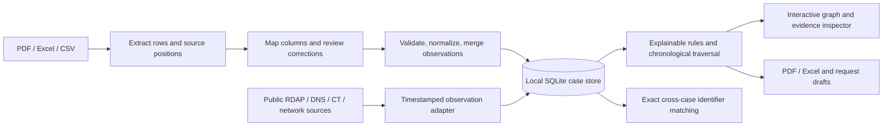

# Architecture and evidence model

Trace-X is a local React + TypeScript client with an Express + TypeScript service. Shared pure analysis functions keep browser explanations and server report findings consistent. SQLite stores case JSON, configurable rules and activity events; original uploads are saved by SHA-256 under the ignored data directory.

## Core objects

| Object             | Purpose                                                                                                |
| ------------------ | ------------------------------------------------------------------------------------------------------ |
| Case               | Complaint summary, chosen starting UTR, account/entity collections and evidence                        |
| Transaction        | Directed observed transfer with integer-paise amount, original timestamp, normalized UTC and precision |
| Evidence reference | Original file/evidence identifier, page/row position and original raw values                           |
| Account            | Stable supplied identifier, display label and statement-availability flag                              |
| Indicator          | Domain/IP/UPI/phone supplied in evidence, with optional explicitly sourced account association         |
| Lookup             | Source-attributed, time-stamped live observation or explicitly labelled synthetic fixture              |
| Rule finding       | Deterministic explanation, score contribution and supporting transaction IDs                           |

Amounts are stored as integer paise. The money-trail algorithm starts with a unique UTR and traverses chronological outgoing transfers up to a configurable hop limit. It does not sum transfer amounts across hops as loss or recovery. An earliest-reach state prevents following an account's older outgoing transactions. Cycles are finite because transfer IDs are visited once and traversal is hop bounded.

For matching, the sender, recipient, amount, currency, timestamp, precision and nonempty reference must match. Alternate source observations are attached to the existing transfer. Missing references retain separate rows, and conflicting references remain distinct so a starting-UTR ambiguity can be surfaced. This deliberately conservative approach may leave probable matches unmerged; it does not invent certainty.

Each risk rule contributes at most once. Rapid-forwarding analysis excludes date-only rows and compares subsequent outgoing values within the configured interval to the incoming value. This tests temporal proximity; it is not a tracing/allocation formula. The fan-in rule uses a rolling 24-hour window over distinct supplied sender identifiers. Other rules are scoped to the available case records; users see the coverage limitations.

## Public intelligence

Only fixed public intelligence endpoints and a recursive DNS resolver are queried. No requests are sent to the investigated web server itself. Source failures are returned as unavailable/partial results and saved with the observation. Successful recent observations are reused for one hour. Three concurrent live lookups are allowed.

Domains and IPs are input-validated. No arbitrary URL fetch endpoint is exposed. Reserved `.example` names are kept in fixture mode. User-supplied domain queries are disclosed to the selected public intelligence providers; the UI states this before lookup.

## Local security boundaries

The service binds to loopback and checks the Host and Origin hostnames. There is no remote deployment, login system or user-role model in this milestone. The service limits upload sizes and row/page counts; preview sessions expire after 30 minutes. SQL writes use parameters. The UI renders evidence as text. Spreadsheet strings are written as string cells rather than executable formulas.

Original upload bytes are retained even after reviewed field corrections. A source hash is recorded, and the evidence content and local activity log preserve mapping, corrections and exclusions. Hashes and local logs are not represented as a certified or tamper-proof chain of custody.
